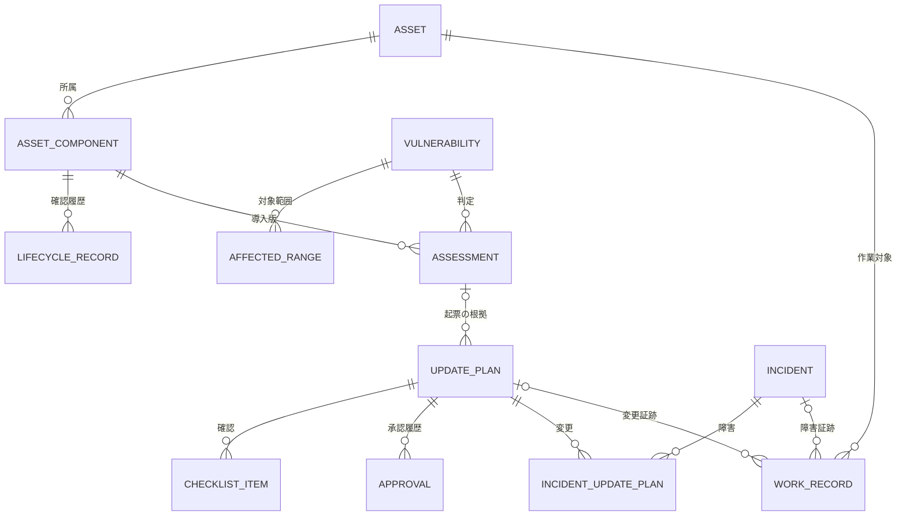

# データモデル

業務テーブルは 21 個です。業務サービスは `assets.asset_type` が `Service` の行で表します。Laravel のセッション、キャッシュ、ジョブなどの基盤テーブルは集計外です。

| グループ | テーブル | 主な関連と役割 |
| --- | --- | --- |
| ユーザーと権限 | `users` | ログインユーザー。作業者、起票者、承認者、検証者の参照先。 |
|  | `roles` | Admin、Operator、Reviewer、Viewer の固定ロール。 |
|  | `role_user` | ユーザーとロールの多対多。兼任者の承認権限は Reviewer の行に付与者・理由・範囲を記録。 |
| 資産とライフサイクル | `assets` | 台帳の親。業務サービス、サーバー、アプリケーションなどを格納。 |
|  | `asset_components` | 資産に属する OS、PHP、DB などの製品、導入版と版の情報源。 |
|  | `asset_relationships` | 資産間の有向関連。参照元、参照先、依存の種類を保持。 |
|  | `component_lifecycle_records` | コンポーネントごとの履歴。版、サポート段階、期日と精度、出典、確認日時を保存。 |
| 脆弱性 | `vulnerability_records` | 通報、深刻度、悪用確認状況、影響判断の元情報。 |
|  | `vulnerability_affected_ranges` | 通報に属する製品別の対象版の式と修正版。`affected_version_expression` は TEXT。 |
|  | `vulnerability_component_assessments` | 通報とコンポーネントの判定。導入版のスナップショット、判定、処理、証拠、処理結果を保持。 |
| 更新と変更 | `update_plans` | 変更の理由、影響、現行版・候補版、進行状態、予定と実績。脆弱性から起票した場合は `source_assessment_id` で起点を参照。 |
|  | `update_plan_assets` | 計画と資産の多対多。対象業務サービスも資産として関連付け。 |
|  | `update_plan_components` | 計画とコンポーネントの多対多。所属資産も保存。 |
|  | `update_checklist_items` | 計画の五段階の確認項目。証跡、担当者、免除、再検証の関連を保持。 |
|  | `change_approvals` | 計画への承認・差し戻しを追記。発起人、実施担当者、承認者、決定時刻を保存。 |
| 障害と作業 | `incidents` | 障害の影響、所見、復旧と検証。関連する脆弱性は任意で参照。 |
|  | `incident_assets` | 障害と影響範囲の資産の多対多。 |
|  | `incident_components` | 障害と影響範囲のコンポーネントの多対多。所属資産も保存。 |
|  | `incident_update_plans` | 障害と関連変更・後続計画の多対多。 |
|  | `work_records` | 資産と作業者に属する証跡。変更計画・障害は任意の参照。訂正は原記録にひも付けて追記。 |
|  | `audit_events` | 対象型・対象 ID、操作、前後の値、操作者と記録時刻。 |

## 関連をたどる

## 整合性と履歴の制約

- `asset_code`、`vulnerability_code`、`plan_code`、`incident_code`、`record_code` は一意です。コンポーネント関連の複合外部キー `(component_id, asset_id)` は `asset_components(id, asset_id)` を参照します。計画や障害に選んだ資産との一致はサーバーがトランザクション内で確認し、範囲外の指定を 422 で拒否します。
- ライフサイクルの履歴は `UNIQUE(component_id, verified_at)` で重複を防ぎます。現在の参照は `currentLifecycle()` の `latestOfMany('verified_at')` です。期限不明や再確認期限超過は区別して表示します。現行の導入版が変わっても当時のスナップショットを保持します。
- 通報の `exploited_status`、コンポーネントの `match_status`、対応の `handling_status` は独立しています。`VersionComparator` で解析できないときは `RANGE_UNRESOLVED` と `ASSESSING` を記録し、`resolution_note` を必須とします。確定後の再判定は `supersedes_assessment_id` で原判定を参照します。
- 変更の保留元は `blocked_from_status` に保存します。`waiver_scope` は項目・段階・計画の範囲を残します。不合格の再検証は `update_checklist_items.correction_of_id` で元の項目を参照します。
- `change_approvals` の CHECK 制約は `approver_id` と `initiated_by`、`executed_by` の一致を拒否します。登場するユーザーの外部キーは削除を制限し、責任者の参照を保ちます。
- ロールバック失敗時は状態更新、障害作成、影響範囲と計画の関連、作業・監査の追加を同じトランザクションで行います。障害の独立検証には `resolution_verified_by` と `resolution_verified_at`、更新競合の検出には `version` を使います。閉じた障害の再開先は `reopened_from_id` で元の障害を参照します。
- 作業記録の訂正は `work_records.correction_of_id` を持つ別の行です。監査は `(auditable_type, auditable_id, created_at)` の複合インデックスで対象と期間を検索できます。作業・監査記録の権限分離はセキュリティ文書に記載しています。 [セキュリティ](SECURITY-ja.md)

## デモの再投入

資産・通報・計画・障害・作業のコード、ユーザー名、ロール名が再投入時の照合キーです。コンポーネントは資産コード・種類・製品名、ライフサイクル履歴はコンポーネントと確認日時で照合します。実施済みの計画、承認、作業・監査の履歴は再投入時も維持します。
